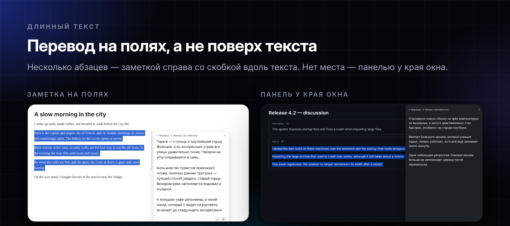
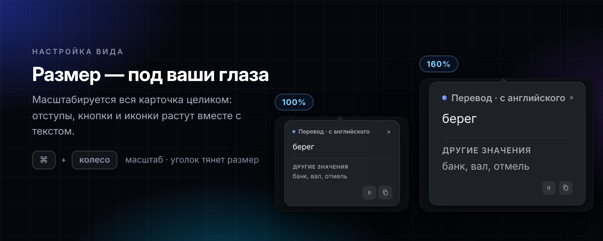

[Русский](README.md) · **English**

[**Download the latest release**](https://github.com/StrangerOfDawah/sensemark/releases/latest) · Chrome · Manifest V3 · free or OpenAI · [Privacy](PRIVACY.en.md)

> The interface is in Russian and the extension translates **into** Russian — the source language is detected automatically. To target another language, change `targetLang` in `DEFAULTS` inside `background.js` and `options.js`.

A Russian selection is ignored without opening the card or calling the API, including small technical insertions such as `dev-секрет`, `APP_ENV`, a URL, or the ChatGPT name. When a selection contains genuinely separate Russian and foreign-language sentences, Russian fragments stay unchanged while the remaining fragments are translated and displayed in separate source-language sections.

Before a request, Sensemark cleans the selection locally: it removes menus, site header and footer, buttons, footnote markers, hidden text, icon-font symbols, and Unicode control characters. Links inside the text, paragraphs, and line breaks are kept. Even when a whole page is selected, the model mostly receives the text itself and skips leftover interface labels on its own.

 

## No waiting for the translation

The response streams: the card opens together with the first translated characters while the rest is still being written. No empty loading card is shown — if the response is slow, a small "Перевожу с английского…" pill appears next to the selection and shrinks into a circle with a running arc.

Close the card mid-translation and the request aborts — unfinished tokens aren't billed.

 

## A card that matches the page

The card takes the colours of the site you are reading: white on a white page, dark on a dark one, warm on a sepia one, and the translation uses the page's text size. In the "Оформление" settings you can pin a light or dark theme, pick the translation font (System, Golos Text or Literata) and turn off "same size as the page".

 

## Long text goes to the margin

A short fragment is translated in a card under the selection. A long one (about 300+ characters or several paragraphs) appears as a note in the right margin, or as a panel at the window edge when there is no room. The text stays visible, and the card moves with it while you scroll.

 

## When selection does not work

Click the Sensemark toolbar icon to open a compact manual-translation popup. Paste up to 5000 characters: translation starts automatically after a paste or a short typing pause, with no extra button.

Manual mode reuses the same streaming request, local Russian-text guard, multilingual sections, and amber explanation state for names and unknown terms. Results can be copied, and editing or clearing the source aborts the unfinished API request immediately.

 

## One word, the right meaning

Selected a single word? The extension picks up the surrounding sentence and asks for the translation that fits *that* sentence. Other common meanings are listed underneath, in case you needed a different one.

If the selection is not a common word — for example, it is a name, title, username, brand, or typo — Sensemark does not invent a translation. The card switches to a separate amber **Explanation** state, shows the fragment category, and gives a brief, cautious description based on its spelling and context. If there is not enough information, it identifies the fragment as a likely proper name or title.

The card lives in a Shadow DOM, so site styles can't break it.

 

## Sized for your eyes

The whole card scales, not just the font — padding, buttons and icons grow with the text. <kbd>⌘</kbd>/<kbd>Ctrl</kbd> + wheel uses small, smoothly animated steps with a trackpad rate limit. The corner grip resizes it, a double-click resets everything. The setting persists across every page.

 

## Settings: free or smarter

The free mode works right after installation — nothing to configure. In the settings you can switch to OpenAI with your own key and choose the card theme, font and size. There is no "Save" button: everything applies immediately.

 

## Install

1. Download the archive from the [**Releases**](https://github.com/StrangerOfDawah/sensemark/releases/latest) page and unpack it
2. Open `chrome://extensions`
3. Turn on **Developer mode** — the toggle in the top right
4. Click **Load unpacked** and select the unpacked folder

Don't delete or rename the folder afterwards — Chrome loads the extension straight from it. Put it somewhere permanent.

Until the Chrome Web Store listing is published, the extension is installed manually. Chrome will remind you about developer mode on startup; that's normal for extensions installed this way.

 

## Test build from a PR

For every pull request and every change to `main`, GitHub Actions runs unit and DOM integration tests, end-to-end tests in real Chromium with the extension loaded (`npm run test:e2e`, OpenAI replaced by a stub), enforces coverage thresholds (90% lines, 75% branches, 95% functions), validates the Manifest V3 structure, and checks every packaged runtime file. Any failure stops the job and prevents publication of the test artifact.

After a successful run, open **PR test build** on the Actions tab, download the `sensemark-pr-N` artifact, unzip it, and load the resulting folder from `chrome://extensions` → **Load unpacked**.

The artifact is retained for 14 days and contains no API keys or user settings. A separate Chrome profile keeps the test build isolated from the installed release. The workflow can also be started manually with **Run workflow**.

 

## Development and AI agents

Before changing the project, read the [AI agent instructions](AGENTS.md), [architecture](docs/ARCHITECTURE.md), [recorded decisions](docs/DECISIONS.md), and [product direction](docs/PRODUCT_DIRECTION.md). Every feature and bug fix must include an automated test, and affected Markdown files must be updated in the same PR.

Release history is in [CHANGELOG.md](CHANGELOG.md); the publication checklist is in [docs/RELEASING.md](docs/RELEASING.md).

 

## OpenAI key

Sensemark has two modes, chosen in settings. The default is **free**: Chrome's built-in on-device translator (Chrome 138+, desktop, https pages) — no key, no cost, the text never leaves the computer. **OpenAI** is smarter (word sense from context, explanations of names, cleans leftover page noise) and costs about $1 a year with daily use. For OpenAI you need an API key. This is **not** a ChatGPT Plus subscription — that gives no programmatic access. The API is billed separately, per use.

1. Create a key at [platform.openai.com/api-keys](https://platform.openai.com/api-keys) and top up your balance
2. Click the extension icon, then the settings button in the top-right corner
3. Choose the **OpenAI** mode, paste the key and hit **Проверить ключ** (Test key)

**On cost.** The default is the cheapest current model, `gpt-6-luna`, with reasoning turned off; instructions are short and in English. Pricing depends on OpenAI's current rates. Track spending at [platform.openai.com/usage](https://platform.openai.com/usage), where you can also configure limits.

 

## Usage

| Method | How |
| --- | --- |
| Keyboard shortcut | Select text → <kbd>⌘</kbd><kbd>⇧</kbd><kbd>Y</kbd> (Mac) or <kbd>Ctrl</kbd><kbd>⇧</kbd><kbd>Y</kbd> (Windows) |
| Context menu | Select text → right-click → «Перевести на русский» |
| Automatic | On right after installation — a mouse selection is translated after half a second. Turn it off in settings or with the ⏸ button in the card. Pressing <kbd>⌘</kbd>/<kbd>Ctrl</kbd>+<kbd>C</kbd> or the right mouse button right away cancels it; selections inside input fields are ignored |
| Pause | The ⏸ button on the card pauses auto-translation for 5 minutes or turns it off. Turn it back on in settings or by right-clicking the Sensemark toolbar icon |
| Manual | Click the extension icon → paste text; translation starts automatically |
| Scale | <kbd>⌘</kbd>/<kbd>Ctrl</kbd> + scroll over the card |

In the card: the icon button copies the translation, ⏸ pauses or turns off auto-translation. Close it with <kbd>Esc</kbd>, the × or a click outside. Scrolling does not close the card: it moves with the text.

You can rebind the shortcut at `chrome://extensions/shortcuts`. If it doesn't work right away, check there that the combination is actually assigned — Chrome silently leaves the field empty when another extension already claims it.

 

## How it works

| File | Purpose |
| --- | --- |
| `manifest.json` | Manifest, permissions, keyboard shortcut |
| `background.js` | Service worker: context menu, OpenAI streaming, translation cache |
| `builtin-translator.js` | Free mode: Chrome's built-in on-device translator |
| `language-detection.js` | Local check for whether the selected text needs translation |
| `selection-text.js` | Selection cleanup: page noise and control characters |
| `word-response.js` | Word-response parser: regular translation or name/title explanation |
| `text-response.js` | Parser for regular and sectioned multilingual translations |
| `manual-translation.js` | Manual-request planning and response parsing without duplicating API logic |
| `popup.html` · `popup.css` · `popup.js` | Compact manual streaming-translation popup |
| `ui-scale.js` | Card scaling step and trackpad rate limiting |
| `content.js` | On-page card, context extraction, scale and size |
| `options.html` · `options.js` | Settings page |
| `icons/` | Icons, 16–128 |

In free mode the text is translated on the device and is not sent anywhere. In OpenAI mode the key is stored in `chrome.storage.local`, and selected or manually entered text and, for a short selection, its surrounding sentence are sent directly to OpenAI. The extension has no developer-operated server and no analytics; see the [privacy policy](PRIVACY.en.md) for details.

Repeat translations of the same fragment come from an in-memory cache in the service worker (last 200) and cost nothing. Selections are capped at 5000 characters so an accidental <kbd>⌘</kbd><kbd>A</kbd> doesn't send a whole page to the API.

If a selection exists only as an image and the page provides no foreign-language text layer, Sensemark shows a local message and sends nothing to the API. Automatic OCR is intentionally avoided because it would add cost and could corrupt the text.

 

## Limitations

- Works only where Chrome lets extensions run scripts: the card won't appear on `chrome://` pages, the Chrome Web Store, or other extensions' pages
- Text inside a PNG, photograph, or canvas cannot be translated through a normal text selection; the extension does not upload such images and asks the user to select an available text label
- The target language is fixed to Russian on purpose — the value goes straight into the system prompt, so there's no free-text field
- After editing the code, press Reload on the extension card in `chrome://extensions` and refresh open tabs

 

## License

MIT — see [LICENSE](LICENSE).

OpenAI is a trademark of its respective owner. This is an independent project and is not affiliated with or endorsed by OpenAI.
