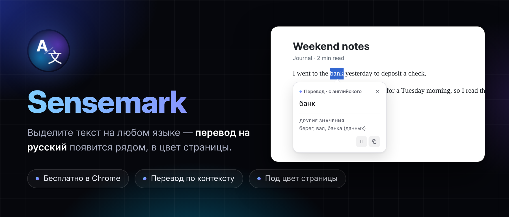
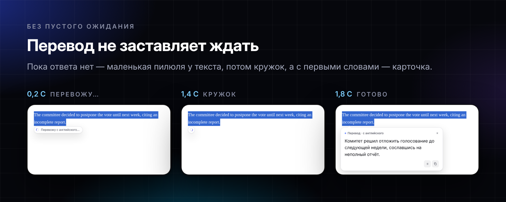
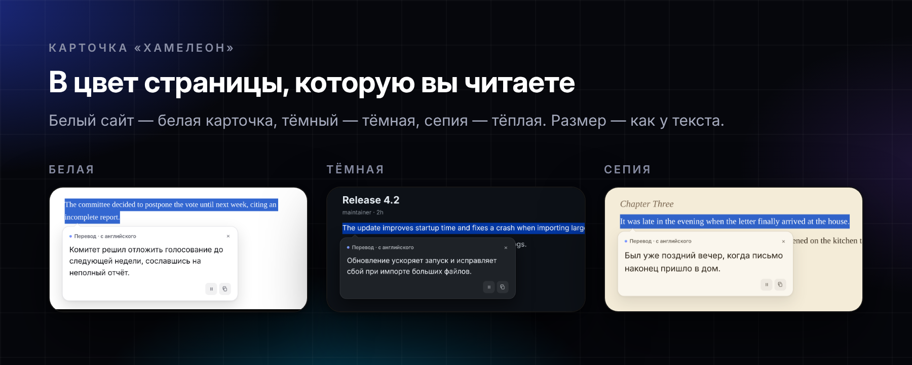
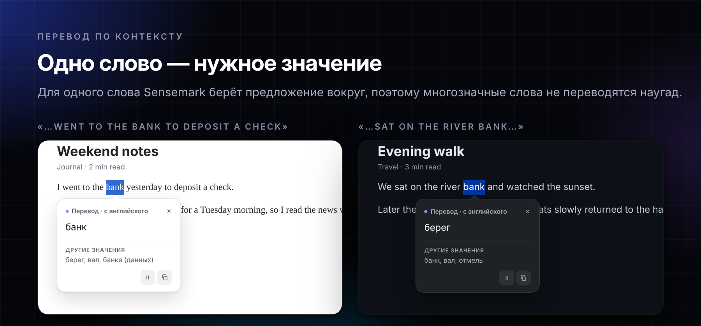
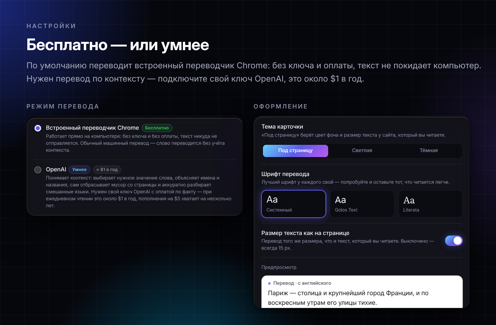

<div align="center">

**Русский** · [English](README.en.md)

</div>



<div align="center">

[**Скачать последнюю версию**](https://github.com/StrangerOfDawah/sensemark/releases/latest) · Chrome · Manifest V3 · бесплатно или OpenAI · [Конфиденциальность](PRIVACY.md)

[](https://github.com/StrangerOfDawah/sensemark/actions/workflows/pr-build.yml)
[](https://github.com/StrangerOfDawah/sensemark/releases/latest)
[](LICENSE)

</div>

> Sensemark переводит **на русский с автоматически определяемого исходного языка** — выбирать язык вручную не нужно.

Выделение на русском игнорируется без открытия карточки и запроса к API — в том числе когда внутри есть небольшие технические вставки вроде `dev-секрет`, `APP_ENV`, URL или название ChatGPT. Если в одном выделении действительно смешаны русское и иностранное предложения, русские фрагменты остаются без изменений, а остальные переводятся и показываются отдельными секциями с названием исходного языка.

Перед запросом Sensemark локально очищает выделение: убирает меню, шапку и подвал сайта, кнопки, сноски, скрытый текст, символы иконок и управляющие Unicode-символы. Ссылки внутри текста, абзацы и переносы строк сохраняются. Даже если выделить страницу целиком, модель получает в основном сам текст, а остатки интерфейса она пропускает сама.

<br>

## Перевод не заставляет ждать

Ответ идёт потоком: карточка открывается вместе с первыми буквами перевода, пока остальное ещё дописывается. Пустого окна загрузки нет — если ответ задерживается, у выделения появляется маленькая пилюля «Перевожу с английского…», которая сжимается в кружок с бегущей дугой.



Закрыли карточку посреди перевода — запрос обрывается, недогенерированные токены не оплачиваются.

<br>

## Карточка под страницу

Карточка берёт цвета сайта, на котором вы читаете: на белом она белая, на тёмном — тёмная, на «сепии» — тёплая, а перевод того же размера, что и текст страницы. В настройках «Оформление» можно закрепить светлую или тёмную тему, выбрать шрифт перевода (системный, Golos Text или Literata) и выключить размер «как на странице».



<br>

## Длинный текст — на полях

Короткий фрагмент переводится карточкой под выделением. Длинный (от ~300 символов или несколько абзацев) — заметкой на полях справа от текста, а если справа нет места — панелью у правого края окна. Текст при этом остаётся открытым, а карточка едет вместе с ним при прокрутке.


<br>

## Если выделение не сработало

Нажмите на иконку Sensemark в панели Chrome — откроется компактное окно ручного перевода. В него можно вставить до 5000 символов: после вставки или короткой паузы при наборе перевод начнётся автоматически, без дополнительной кнопки.

Ручной режим использует тот же потоковый перевод, локальный фильтр русского текста, многоязычные секции и янтарное объяснение неизвестных имён и названий. Результат можно скопировать; изменение или очистка текста сразу отменяют незавершённый API-запрос.

<br>

## Одно слово — нужное значение

Выделили одно слово? Расширение само подхватит предложение вокруг и попросит перевод именно в этом смысле. Под основным переводом покажет остальные частые значения — на случай, если нужно было другое.

Если выделенный фрагмент не является общеупотребительным словом — например, это название, имя, никнейм или опечатка — Sensemark не станет придумывать перевод. Карточка переключится в отдельный янтарный режим **«Объяснение»**, покажет категорию фрагмента и кратко опишет по написанию и контексту, что это может быть. Если определить не получится, аккуратно укажет, что это, вероятно, имя или название.



Карточка живёт в Shadow DOM, поэтому стили сайта её не ломают.

<br>

## Размер — под ваши глаза


Масштабируется вся карточка, а не только шрифт: отступы, кнопки и иконки растут вместе с текстом. Изменение через <kbd>⌘</kbd>/<kbd>Ctrl</kbd> + колесо идёт небольшими плавными шагами и ограничено по скорости для трекпада. Уголок справа снизу тянет размер, двойной клик по нему всё сбрасывает. Настройка сохраняется и работает на всех страницах.

<br>

## Настройки: бесплатно или умнее



Сразу после установки работает бесплатный режим — ничего настраивать не нужно. В настройках можно переключиться на OpenAI со своим ключом, выбрать тему, шрифт и размер карточки. Кнопки «Сохранить» нет: всё применяется сразу.

<br>

## Safari

Есть версия для Safari на Mac (macOS 26.4+). Бесплатный режим там переводит системным переводчиком Apple, режим OpenAI работает так же, как в Chrome. Публикации в App Store нет: расширение собирается в Xcode с обычным Apple ID. Набор `sensemark-safari-vX.Y.Z.zip` лежит в [Releases](https://github.com/StrangerOfDawah/sensemark/releases/latest) рядом с версией для Chrome, пошагово — в [platforms/safari/README.md](platforms/safari/README.md).

<br>

## Установка

1. Скачайте архив со страницы [**Releases**](https://github.com/StrangerOfDawah/sensemark/releases/latest) и распакуйте
2. Откройте `chrome://extensions`
3. Включите **Режим разработчика** — тумблер справа сверху
4. Нажмите **Загрузить распакованное расширение** и выберите распакованную папку

Папку после этого нельзя удалять или переименовывать — Chrome загружает расширение прямо из неё. Положите её туда, где она останется надолго.

До публикации в Chrome Web Store расширение устанавливается вручную. Chrome будет показывать напоминание про режим разработчика при запуске — это нормально для расширений, установленных таким способом.

<br>

## Тестовая сборка из PR

Для каждого pull request и каждого изменения `main` GitHub Actions запускает unit- и DOM-интеграционные тесты, e2e-тесты в настоящем Chromium с загруженным расширением (`npm run test:e2e`, OpenAI подменяется заглушкой), проверяет обязательные пороги покрытия (90% строк, 75% ветвей, 95% функций), структуру Manifest V3 и полный состав архива. Любая ошибка останавливает job и тестовая сборка не публикуется. После успешной проверки workflow прикрепляет распаковываемый артефакт `sensemark-pr-N`.

Откройте нужный запуск **PR test build** на вкладке Actions, скачайте артефакт, распакуйте его и загрузите полученную папку через `chrome://extensions` → **Загрузить распакованное расширение**.

Артефакт хранится 14 дней и не содержит API-ключей или пользовательских настроек. Для проверки удобно использовать отдельный профиль Chrome, чтобы тестовая версия не пересекалась с установленным релизом. Workflow также можно запустить вручную через **Run workflow**.

<br>

## Разработка и AI-агенты

```bash
npm ci --ignore-scripts
npm run verify      # линтер, форматирование, структура, тесты с покрытием
npm run test:e2e    # настоящий Chromium с расширением
```

Документация для разработчиков на английском: [инструкции для AI-агентов](AGENTS.md), [как внести вклад](CONTRIBUTING.md), [архитектура](docs/architecture.md), [принятые решения](docs/adr/README.md) и [направление продукта](docs/product-direction.md). Каждая новая функция и каждое исправление бага обязаны включать автоматический тест, а связанные Markdown-файлы должны актуализироваться в том же PR.

История версий находится в [CHANGELOG.md](CHANGELOG.md), порядок публикации — в [docs/releasing.md](docs/releasing.md).

<br>

## Два режима: бесплатно или умнее

Режим выбирается в настройках, при установке по умолчанию включён бесплатный.

| | Встроенный переводчик Chrome | OpenAI |
| --- | --- | --- |
| Цена | Бесплатно | Около $1 в год при ежедневном чтении — $5 хватает на несколько лет |
| Ключ | Не нужен | Свой ключ OpenAI API |
| Где переводится | Прямо на компьютере, текст никуда не отправляется | В OpenAI |
| Качество | Обычный машинный перевод | Значение слова по контексту, объяснение имён и названий, сам убирает мусор со страницы |
| Требования | Chrome 138+ на компьютере, страницы https | Любая страница |

**Бесплатный режим.** Для каждого нового языка Chrome один раз скачивает языковой пакет — карточка показывает прогресс. Для одного слова дополнительно показывается перевод всего предложения: встроенный переводчик не выбирает значение по контексту, а так смысл виден сразу.

**Режим OpenAI.** Нужен ключ OpenAI API — это **не** подписка ChatGPT Plus, она программного доступа не даёт.

1. Заведите ключ на [platform.openai.com/api-keys](https://platform.openai.com/api-keys) и пополните баланс
2. Нажмите на иконку расширения, затем на шестерёнку справа сверху
3. Выберите режим **OpenAI**, вставьте ключ и нажмите **Проверить ключ**

Используется самая экономичная актуальная модель `gpt-6-luna` без «размышлений». Инструкции модели короткие и на английском (это примерно вдвое дешевле русских), повторные переводы берутся из кэша, длина ответа ограничена. Расход видно на [platform.openai.com/usage](https://platform.openai.com/usage), там же можно настроить лимиты.

<br>

## Как пользоваться

| Способ | Как |
| --- | --- |
| Горячая клавиша | Выделить текст → <kbd>⌘</kbd><kbd>⇧</kbd><kbd>Y</kbd> (Mac) или <kbd>Ctrl</kbd><kbd>⇧</kbd><kbd>Y</kbd> (Windows) |
| Контекстное меню | Выделить текст → правый клик → «Перевести на русский» |
| Автоматически | Включено сразу после установки — выделение мышью переводится через полсекунды. Выключить можно в настройках или кнопкой ⏸ в карточке. Если сразу нажать <kbd>⌘</kbd>/<kbd>Ctrl</kbd>+<kbd>C</kbd> или правую кнопку, перевод не запустится; в полях ввода автоперевод не срабатывает |
| Пауза | Кнопка ⏸ в карточке: пауза на 5 минут или полное выключение автоперевода. Включить обратно — в настройках или правым кликом по значку Sensemark |
| Вручную | Нажать на иконку расширения → вставить текст; перевод начнётся сам |
| Масштаб | <kbd>⌘</kbd>/<kbd>Ctrl</kbd> + колесо над карточкой |

В карточке: кнопка-иконка копирует перевод, ⏸ ставит автоперевод на паузу или выключает его. Закрыть — <kbd>Esc</kbd>, крестик или клик мимо. При прокрутке карточка не закрывается, а едет вместе с текстом.

Горячую клавишу можно переназначить на `chrome://extensions/shortcuts`. Если она не сработала сразу — проверьте там, что комбинация назначена: Chrome молча оставляет поле пустым, когда сочетание уже занято другим расширением.

<br>

## Устройство

| Папка или файл | Назначение |
| --- | --- |
| `src/manifest.json` | Манифест, разрешения, горячая клавиша |
| `src/background.js` | Service worker: контекстное меню, стриминг из OpenAI, кэш переводов |
| `src/builtin-translator.js` | Бесплатный режим: встроенный переводчик Chrome или переводчик Apple в Safari |
| `src/language-detection.js` · `selection-text.js` | Локально: нужно ли переводить и очистка выделения |
| `src/word-response.js` · `text-response.js` | Разбор ответа: слово, имя/название, обычный и многоязычный текст |
| `src/card-theme.js` · `ui-scale.js` | Цвета под страницу, шрифты, выбор места карточки, масштаб |
| `src/content/` | Всё на странице: карточка, пилюля статуса, разбор контекста, расчёт положения, стили |
| `src/popup.*` · `manual-translation.js` | Окно ручного перевода по клику на иконку |
| `src/options.*` | Страница настроек |
| `src/fonts/` · `src/icons/` | Шрифты Golos Text и Literata (лицензия OFL) и иконки |
| `platforms/safari/` | Версия для Safari: Swift-часть и установщик |

Подробно — в [архитектуре](docs/architecture.md).

В бесплатном режиме текст переводится на компьютере и никуда не отправляется. В режиме OpenAI ключ хранится в `chrome.storage.local`, а выделенный или вручную введённый текст и, для короткого выделения, окружающее предложение отправляются напрямую в OpenAI. У расширения нет сервера разработчика и аналитики; подробности — в [политике конфиденциальности](PRIVACY.md).

Повторные переводы одного фрагмента берутся из кэша (200 последних, живёт до закрытия браузера) и не тратят токены. Ограничение на длину — 5000 символов за раз, чтобы случайный <kbd>⌘</kbd><kbd>A</kbd> не ушёл в API целой страницей.

Если выделенный фрагмент существует только как изображение и у страницы нет иностранного текстового слоя, Sensemark показывает локальное сообщение и ничего не отправляет в API. Автоматический OCR намеренно не запускается: он увеличил бы стоимость и мог бы исказить текст.

<br>

## Ограничения

- Работает только там, где Chrome разрешает расширениям выполнять скрипты: на `chrome://`, в Chrome Web Store и на страницах других расширений карточка не появится
- Текст внутри PNG, фотографии или canvas нельзя перевести обычным выделением; расширение не отправляет такие изображения в OpenAI и предлагает выбрать доступную текстовую подпись
- Язык перевода зафиксирован русским — значение подставляется в системный промпт, поэтому свободного ввода нет намеренно. Меняется в `DEFAULTS` в `src/background.js` и `src/options.js`
- После правок кода нужно нажать «Обновить» на карточке расширения в `chrome://extensions` и перезагрузить открытые вкладки

<br>

## Лицензия

MIT — см. [LICENSE](LICENSE).

OpenAI является товарным знаком соответствующего правообладателя. Это независимый проект, не связанный с OpenAI и не одобренный ею.
